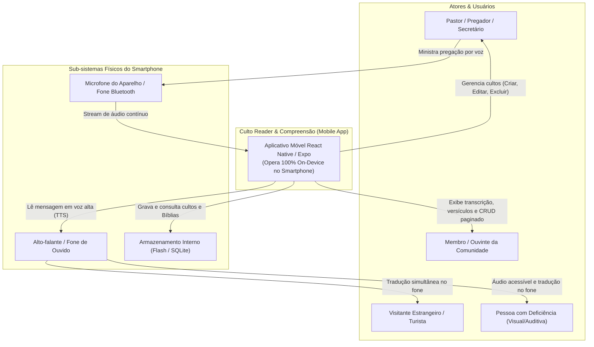
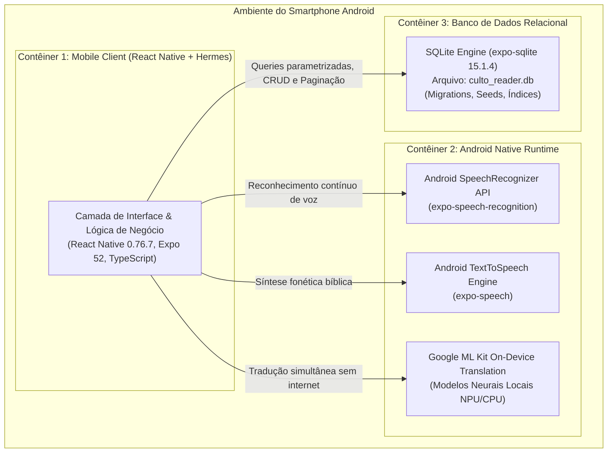
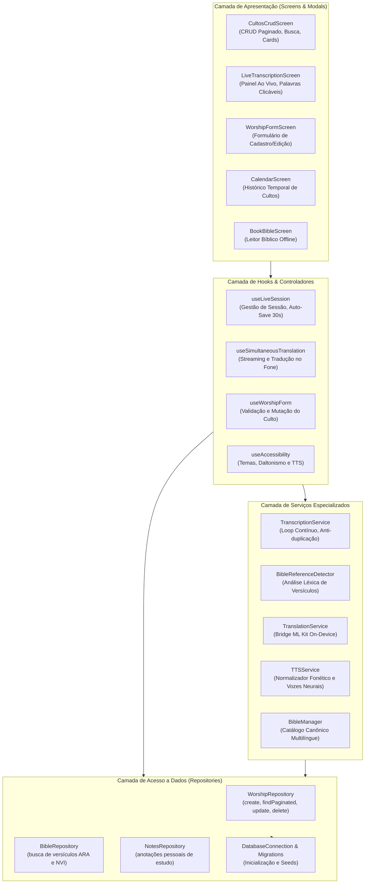
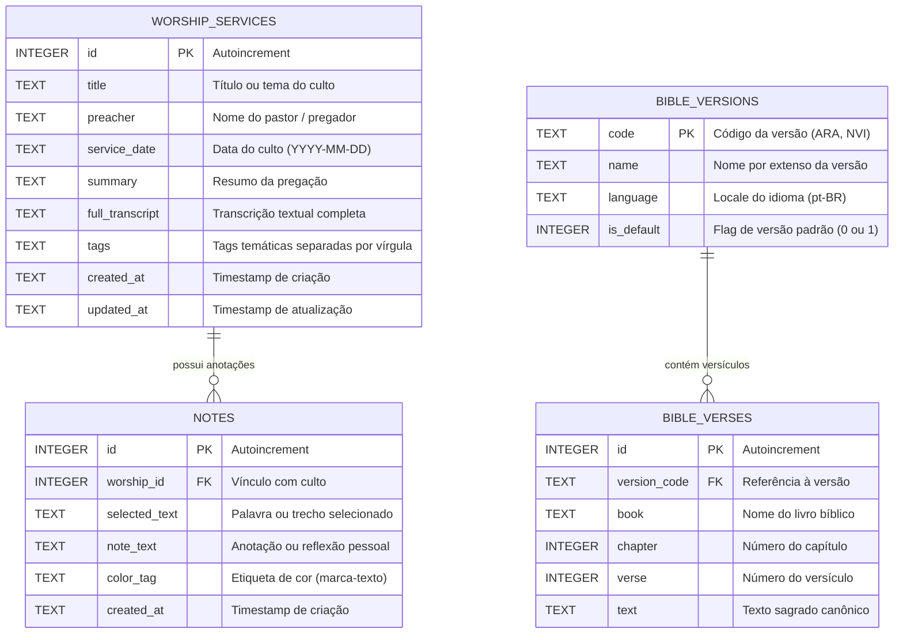

# Culto Reader & Compreensão — Mobile App

[](https://reactnative.dev/)
[](https://expo.dev/)
[-003B57?style=flat-square&logo=sqlite&logoColor=white)](https://docs.expo.dev/versions/latest/sdk/sqlite/)
[](https://www.typescriptlang.org/)
[]()
[](#-arquitetura-em-modelo-c4)

---

## 📖 1. Visão Geral do Produto

### O que é o aplicativo?
O **Culto Reader & Compreensão** é um aplicativo mobile *offline-first* desenvolvido em **React Native com Expo** e banco de dados relacional **SQLite local**. O sistema foi concebido como uma central de transcrição contínua, análise léxica bíblica e gestão corporativa de cultos e mensagens cristãs, operando sem nenhuma dependência de servidores em nuvem ou internet durante as reuniões.

### Para que serve o aplicativo?
O aplicativo atende a três frentes principais de impacto prático:

1. **Gestão e Preservação de Mensagens (CRUD Completo com Paginação):**
   Permite cadastrar, consultar, atualizar e excluir registros de cultos de forma paginada e instantânea, armazenando pregações, pregadores, datas, resumos, tags temáticas e transcrições integrais diretamente no chip de armazenamento do smartphone.
2. **Acessibilidade Universal e Inclusão Sensorial:**
   * **Pessoas com deficiência auditiva:** Acompanham a pregação lendo a transcrição em tempo real na tela.
   * **Pessoas com deficiência visual ou baixa visão:** O aplicativo sintetiza em voz alta (TTS) com entonação bíblica humana natural e vozes neurais brasileiras, além de controle de escala de fonte (100% a 200%).
   * **Pessoas com daltonismo:** Modos de alto contraste e filtros específicos para Protanopia, Deuteranopia e Tritanopia.
3. **Tradução Simultânea para Estrangeiros (On-Device):**
   Permite que visitantes estrangeiros ou turistas acompanhem cultos ministrados em Português lendo a tradução em Inglês, Espanhol ou Francês ou ouvindo cada frase traduzida diretamente em seus fones de ouvido (**Tradução Simultânea Audível estilo ONU**), com inteligência artificial rodando 100% no chip do celular (Google ML Kit).
4. **Detecção Bíblica Inteligente:**
   Analisa o áudio captado pelo microfone e identifica passagens bíblicas citadas pelo orador (ex: *João 3:16*, *Romanos 8:28*, *Salmo 23*), gerando links interativos para leitura da Bíblia offline no texto oficial (Almeida Revista e Atualizada).

---

## 🏛️ 2. Arquitetura em Modelo C4

Para documentar a estrutura com rigor de engenharia de software, o projeto adota o **Modelo C4** (Contexto, Contêineres, Componentes e Código).

---

### Nível 1: Diagrama de Contexto de Sistema (Context)
Descreve os usuários atendidos e as fronteiras físicas do dispositivo onde o aplicativo opera:



---

### Nível 2: Diagrama de Contêineres (Containers)
Evidencia os subsistemas de runtime e as tecnologias empregadas no celular:



---

### Nível 3: Diagrama de Componentes (Components)
Detalhamento interno dos componentes da aplicação móvel:



---

### Nível 4: Diagrama de Código e Modelo Relacional (Code / Schema)
Estrutura física das tabelas relacionais mantidas no SQLite:



---

## 🎯 3. Matriz de Atendimento às Exigências Acadêmicas

| Requisito do Projeto | Implementação Técnica no Código | Localização no Repositório |
| :--- | :--- | :--- |
| **Tecnologia: React Native + Expo + SQLite** | React Native 0.76.7, Expo 52 e `expo-sqlite` 15.1.4 assíncrono. | `package.json`, `src/database/connection.ts` |
| **CRUD: CREATE (Cadastrar)** | Cadastro estruturado via formulário dedicado e auto-geração a partir do rascunho da Tela Ao Vivo. | `app/worship/form.tsx`, `WorshipRepository.create()` |
| **CRUD: READ (Consultar)** | Listagem paginada no SQLite (`LIMIT ? OFFSET ?`), busca em tempo real com `LIKE %term%` e filtro por data. | `app/(tabs)/index.tsx`, `WorshipRepository.findPaginated()` |
| **CRUD: UPDATE (Editar)** | Edição completa de todos os campos com preenchimento reativo do registro existente. | `app/worship/form.tsx`, `WorshipRepository.update()` |
| **CRUD: DELETE (Excluir)** | Exclusão com confirmação nativa (`Alert.alert`) e remoção física no banco. | `app/(tabs)/index.tsx`, `WorshipRepository.delete()` |
| **Pelo menos 10 registros** | População automática (*seeding*) de **11 cultos completos** com metadados e versículos citados na primeira abertura. | `src/database/seeds.ts` |
| **Paginação na listagem** | Controle de paginação com navegação fluida de páginas, indicação de total de registros e páginas. | `src/components/PaginationControls.tsx` |
| **Persistência garantida** | Arquivo SQLite mantido no disco flash do Android, preservando dados após fechar ou reiniciar o aparelho. | `src/database/migrations.ts` |

---

## 💻 4. Como Executar o Projeto

### Pré-requisitos
* [Node.js](https://nodejs.org/) (v18 ou superior)
* [Android Studio](https://developer.android.com/studio) & SDK Android (API 34/35)
* [JDK 17](https://www.oracle.com/java/technologies/javase/jdk17-archive-downloads.html)

### Instalação e Execução

1. **Clonar o repositório:**
   ```bash
   git clone https://github.com/Ranzer-Dev/CultoReader_Mobile.git
   cd CultoReader_Mobile
   ```

2. **Instalar as dependências do ecossistema Expo:**
   ```bash
   npm install
   ```

3. **Executar em modo desenvolvimento no emulador ou dispositivo físico:**
   ```bash
   npx expo run:android
   ```

4. **Gerar pacote APK Release standalone (100% autônomo):**
   ```bash
   cd android
   .\gradlew assembleRelease
   ```
   *O executável otimizado estará disponível em `android/app/build/outputs/apk/release/`.*

---

## 📄 Licença

Projeto desenvolvido para fins acadêmicos e de acessibilidade comunitária sob a licença [MIT](LICENSE).
