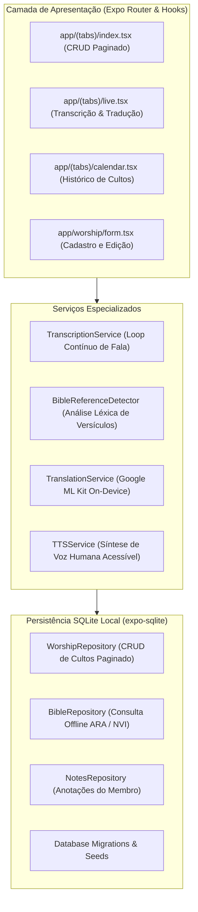

# Culto Reader & Compreensão — Mobile App

[](https://reactnative.dev/)
[](https://expo.dev/)
[-003B57?style=flat-square&logo=sqlite&logoColor=white)](https://docs.expo.dev/versions/latest/sdk/sqlite/)
[](https://www.typescriptlang.org/)
[]()

Aplicativo mobile offline-first para **leitura, compreensão, transcrição contínua e gestão completa de cultos e mensagens cristãs**, desenvolvido em **React Native com Expo** e banco de dados **SQLite local**, incorporando CRUD paginado, detecção bíblica instantânea, tradução simultânea no chip (Google ML Kit) e acessibilidade universal.

---

## 🏛️ Arquitetura do Sistema

O aplicativo foi projetado sob os princípios de **Clean Architecture** e padrão **Repository**, operando de forma 100% autônoma e offline no dispositivo do usuário:



---

## 🚀 Funcionalidades Principais

### 1. Sistema CRUD Completo com Paginação (SQLite)
* **CREATE**: Formulário dedicado com validações, tags, temas, pregador e suporte a ditado por voz, além de fechamento direto da tela ao vivo.
* **READ**: Listagem em cards com paginação real via SQL (`LIMIT ? OFFSET ?`), busca em tempo real por termos (`LIKE %termo%`) e navegação por calendário.
* **UPDATE**: Edição reativa com carregamento instantâneo do registro existente.
* **DELETE**: Exclusão segura com caixa de diálogo nativa de confirmação.
* **Seeds Automáticos**: População de 11 cultos completos e versículos na primeira inicialização.

### 2. Transcrição Contínua de Voz (1 a 4 horas)
* Captação ininterrupta da pregação usando o motor nativo do Android (`expo-speech-recognition`).
* Loop de auto-reconexão inteligente (150ms) que supera a limitação de pausas do sistema operacional.
* Algoritmo de fusão por sobreposição (*merge overlapping*) que elimina gagueiras e duplicações.

### 3. Tradução Simultânea On-Device (Google ML Kit)
* Tradução em tempo real de Português para Inglês, Espanhol ou Francês sem gastar plano de dados.
* **Modo Fone de Ouvido ("🎧 Fone: Ligado")**: Permite que membros ou visitantes estrangeiros ouçam cada frase traduzida diretamente em seus fones de ouvido enquanto o culto acontece.

### 4. Detector Bíblico Instantâneo
* Reconhecimento automático de passagens bíblicas citadas pelo pregador (ex: *João 3:16*, *Romanos 8:28*, *Salmo 23*).
* Geração de chips clicáveis e gaveta de versículos com busca instantânea no banco local da Bíblia (Almeida Revista e Atualizada).

### 5. Acessibilidade Universal
* **Leitura em Voz Alta (TTS)** com cadência bíblica humana e vozes neurais brasileiras.
* **Filtros para Daltonismo**: Protanopia, Deuteranopia e Tritanopia com alto contraste.
* **Escala de Fontes**: Dimensionamento dinâmico de 100% até 200%.

---

## 🛠️ Stack Tecnológica

* **Framework:** [React Native](https://reactnative.dev/) (v0.76.7) com [Expo](https://expo.dev/) (SDK 52)
* **Linguagem:** [TypeScript](https://www.typescriptlang.org/) (v5.3.3)
* **Roteamento:** [Expo Router](https://docs.expo.dev/router/introduction/) (File-based Routing)
* **Banco de Dados:** [SQLite](https://docs.expo.dev/versions/latest/sdk/sqlite/) (`expo-sqlite` v15.1.4)
* **Reconhecimento de Voz:** `expo-speech-recognition`
* **Síntese de Voz:** `expo-speech`
* **Tradução:** Google ML Kit Translate On-Device
* **Ícones:** `lucide-react-native`

---

## 📦 Como Executar o Projeto

### Pré-requisitos
* [Node.js](https://nodejs.org/) (versão LTS recomendada: 18 ou superior)
* [Android Studio](https://developer.android.com/studio) & SDK Android configurado
* [JDK 17](https://www.oracle.com/java/technologies/javase/jdk17-archive-downloads.html)

### Passo a Passo

1. **Clonar o repositório:**
   ```bash
   git clone https://github.com/Ranzer-Dev/CultoReader_Mobile.git
   cd CultoReader_Mobile
   ```

2. **Instalar dependências:**
   ```bash
   npm install
   ```

3. **Executar em modo desenvolvimento:**
   ```bash
   npx expo run:android
   ```

4. **Gerar APK Release standalone:**
   ```bash
   cd android
   .\gradlew assembleRelease
   ```
   *O arquivo `.apk` final será gerado em `android/app/build/outputs/apk/release/`.*

---

## 📄 Licença

Este projeto é desenvolvido para fins educacionais e de acessibilidade comunitária sob a licença [MIT](LICENSE).
